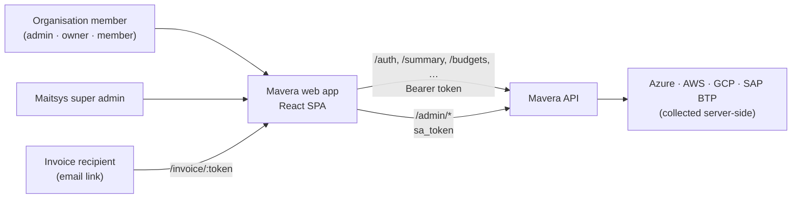
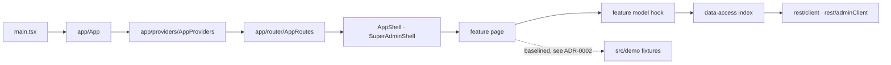

# Mavera architecture

Applies the baseline in [`../rule.md`](../rule.md). The folder layout, provider order, data-access
boundary and checks intentionally match Consultant Pulse so engineers can move between the products.
Decisions and exceptions: [ADR-0001](adr/0001-adopt-maitsys-architecture-standard.md),
[ADR-0002](adr/0002-demo-fixtures-and-data-access.md), [ADR-0003](adr/0003-class-based-styling-retained.md).

## System context



The browser never talks to a cloud provider. The SPA is a client of one API with two independent
sessions: the organisation session and the super-admin session.

## Runtime flow



Provider order (outermost first): theme → error boundary → toasts → confirm dialogs → organisation
session → super-admin session → billing → router. Session providers wrap the router on purpose: the
API client redirects with a hard navigation, not through React Router.

## Folder map

```text
src/
  app/            composition only
    config/       environment.ts — the only reader of import.meta.env
    errors/       ErrorBoundary
    layouts/      AppShell, module navigation, profile menu, search, notifications, footer
    providers/    AppProviders
    router/       route-manifest.ts, AppRoutes.tsx, navConfig.ts (menu tree + visibility rules)
  features/       one capability per folder; pages/ components/ model/ and a public index.ts
    auth  dashboard  cloud  azure  aws  gcp  btp  budgets  recommendations  smartAlerts
    sap  idoc  alerts  reports  invoices  billing  subscription  users  syncLogs
    assistant  superAdmin  system
  shared/
    ui/           product-neutral components (icons, Select, Tooltip, charts, dialogs)
    domain/       pure rules shared by fixtures and features (billing pricing and derivations)
    lib/          permissions, toast events, hard navigation, css variables
    theme/        ThemeProvider, tokens, initial-theme resolution
    types/        cross-feature domain types (auth user, cloud provider)
  data-access/    index.ts (public) + rest/ (axios clients, session probe)
                  + contracts/ (typed shapes) + repositories/ (idoc, cloud insights; demo-backed for now)
  demo/           seeded fixtures per area — see ADR-0002
  styles/         app.css, fonts.css — see ADR-0003
tools/            check-architecture.mjs, architecture-baseline.json
```

## State ownership

| State | Owner | Persistence |
|---|---|---|
| Organisation session (user, modules, features, cloud access) | `features/auth` `AuthProvider`, loaded from `/auth/me` | `localStorage` `token`, `refreshToken` |
| Super-admin session | `features/superAdmin` `SuperAdminAuthProvider` | `localStorage` `sa_token`, `sa_username` |
| Subscription-expired snapshot | API client → `SubscriptionExpiredPage` | `sessionStorage` `ccm_expired_sub` |
| Cloud summary caches | `data-access` (cleared on logout and forced sign-out) | `localStorage` `ccm_*_summary` |
| Theme | `shared/theme` `ThemeProvider` | `localStorage` `mavera.theme` |
| Dashboard and overview data | `features/dashboard` `useDashboardData` (API in a live session, sample data in local development only) | none |
| IDoc Monitoring, Cost Analytics, Resource Inventory, Reserved Instances, Optimization Advisor | `idocRepository` / `cloudInsightsRepository` in data-access (demo-backed) | none; actions are session-local stores in the feature model |
| Other provider pages, SAP, budgets, … | demo fixtures read by the page (baselined) | none; edits are session-local |
| Navigation | React Router | URL |

## Access model

Authentication, permission and visibility are separate:

- **Route access** is declared in `route-manifest.ts` as `public`, `authenticated` or `super-admin` and
  enforced by the layout the route sits in. `route-manifest.test.ts` checks that every menu
  destination is a registered route.
- **Menu visibility and locks** come from `navConfig.ts`, driven by `derivePermissions` (role,
  per-provider view/read-only, org module subscription, feature flags, invoice-only mode).
- **The API is the security boundary.** Hiding or locking a menu item is UX; every protected
  operation must be authorised again server-side.

## Enforcement

`npm run verify` = lint → typecheck → architecture check → tests → build. The architecture check
rejects: files at the `src` root, unknown top-level folders, `fetch`/`axios` outside
`data-access/rest`, `import.meta.env` outside `app/config/environment.ts`, imports of `data-access`
internals, `shared` depending on app/features/data-access/demo, feature internals reached around
`index.ts`, feature-to-feature value cycles, demo values imported into features outside the baseline,
missing feature entrypoints, duplicate or unregistered routes, literal route paths in `AppRoutes`,
and removal of the dark theme, reduced-motion or focus styles.

## Known gaps

| Gap | Where | Plan |
|---|---|---|
| 42 files import demo fixtures directly | `tools/architecture-baseline.json` | Repository per area, ADR-0002 |
| No server-state engine; hooks fetch with axios | `features/dashboard`, `features/auth` | Choose one by ADR before adding repository hooks |
| Routes are not lazy-loaded; one ~1.3 MB bundle | `app/router/AppRoutes.tsx` | Lazy feature entrypoints with route-level loading and error boundaries |
| No generated or contract-tested API client | `data-access` | OpenAPI-generated types once the API publishes a contract |
| Access tokens live in `localStorage` | `data-access/rest/client.ts` | HttpOnly cookie session when the API supports it |

## Repositories (ADR-0002 next step)

New data needs go through a repository in `src/data-access/repositories` with its types in `src/data-access/contracts`, exported from the data-access index. Today `idocRepository` and `cloudInsightsRepository` return copies of the demo fixtures; swapping their bodies for REST calls leaves the pages unchanged. Features never import `src/demo` for new work.
